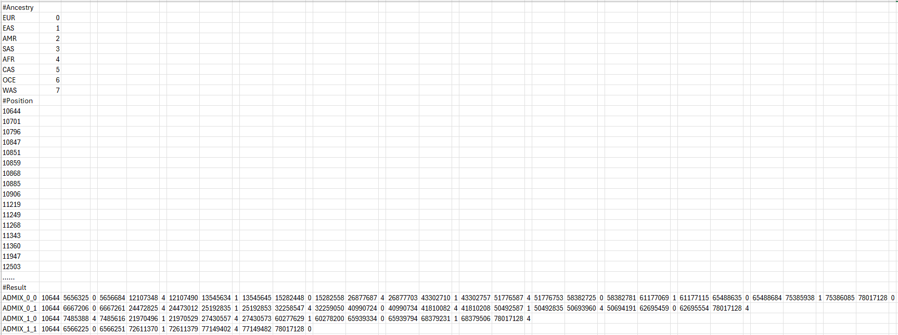
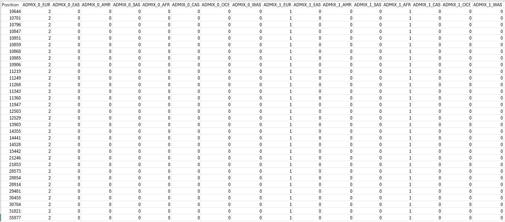

# An example of running the Recomb-Mix Cloud pipeline

## Download Recomb-Mix, compact reference panels, and genetic maps
```
git clone https://github.com/ucfcbb/Recomb-Mix.git
cd Recomb-Mix
```

## Compile Recomb-Mix
```
make -f Makefile
```
Or
```
g++ -std=c++17 -I/opt/conda/include ./src/RecombMix.cpp -o RecombMix -L/opt/conda/lib -Wl,-rpath,/opt/conda/lib -lboost_iostreams -Os -fopenmp
```

## Download PLINK 2
PLINK 2 (https://www.cog-genomics.org/plink/2.0/) is used to filter the markers and samples from the original genomic data. The latest version can be found [here](https://www.cog-genomics.org/plink/2.0/) and its GitHub repository is [here](https://github.com/chrchang/plink-ng/tree/master/2.0/).
```
wget https://s3.amazonaws.com/plink2-assets/alpha7/plink2_linux_x86_64_20260504.zip
unzip plink2_linux_x86_64_20260504.zip
```

## Create a range file for PLINK 2
```
zcat ./compact_panels/eightway_inter/grch37/compact_reference_panel_chr18.vcf.gz | awk '!/^#/ {print "chr18\t"$2"\t"$2}' | gzip > ./compact_panels/eightway_inter/grch37/compact_reference_panel_chr18_ranges.txt.gz
```

## Filter markers and samples using PLINK 2
Assume the query file is `./test/admixture_panel.vcf` and in the GRCh37 build and the sample id file is `./test/admixture_panel_names.txt` (one sample id per line).
```
./plink2 --vcf ./test/admixture_panel.vcf --max-alleles 2 --keep ./test/admixture_panel_names.txt --extract range ./compact_panels/eightway_inter/grch37/compact_reference_panel_chr18_ranges.txt.gz --make-pgen --out ./test/curated_admixture_panel_chr18
```

## Convert file format from PGEN to VCF
PGEN is a new file format introduced by PLINK 2. By default, it outputs *.pgen (binary genotype data), *.pvar (variant information), *.psam (sample information), and *.log files. PLINK 2 supports converting data in PGEN format to VCF format. This step can be combined with the previous one to output the VCF file directly.
```
./plink2 --pfile ./test/curated_admixture_panel_chr18 --export vcf bgz --out ./test/curated_admixture_panel_chr18
```

## Perform local ancestry inference
```
./RecombMix -q ./test/curated_admixture_panel_chr18.vcf.gz -p ./compact_panels/eightway_inter/grch37/compact_reference_panel_chr18.vcf.gz -a ./compact_panels/eightway_inter/compact_reference_panel_ancestry_labels.txt -g ./maps/grch37/genetic_map_GRCh37_chr18.txt -o ./test/ -i curated_admixture_panel_chr18_inferred_local_ancestral_values.txt
```

## Convert ancestry calls to ancestry dosage format
```
g++ -std=c++17 ./utility/convert_ancestry_call.cpp -l boost_iostreams -o ACConverter -Os
./ACConverter -i ./test/curated_admixture_panel_chr18_inferred_local_ancestral_values.txt -o ./test/curated_admixture_panel_chr18_inferred_local_ancestral_values_as_ancestry_dosage.txt -f 1
```

## Result
**Ancestry call run-length encoding format example**



**Ancestry call ancestry dosage format example**


